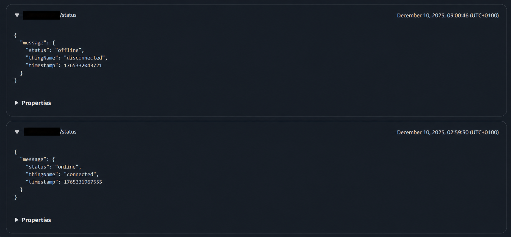
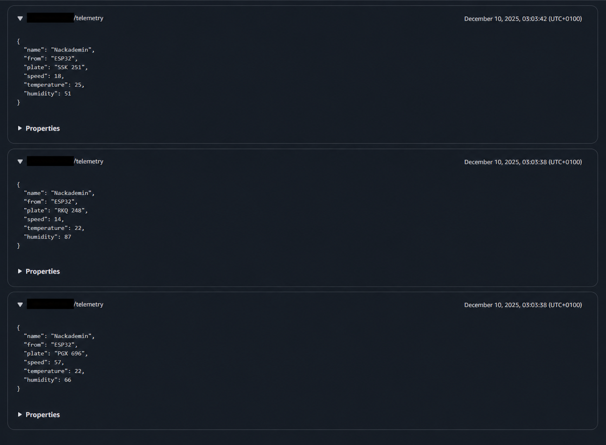
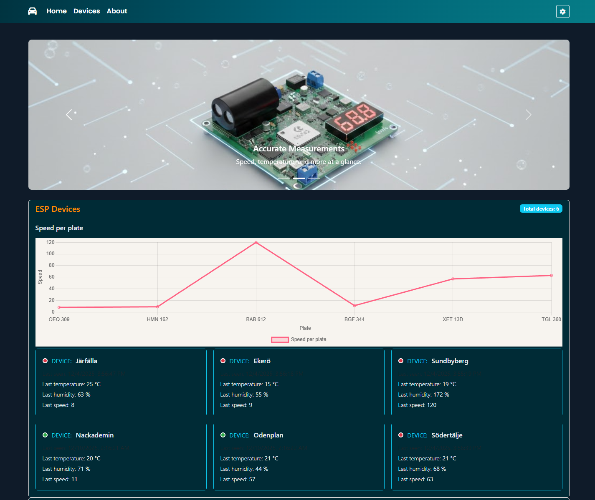
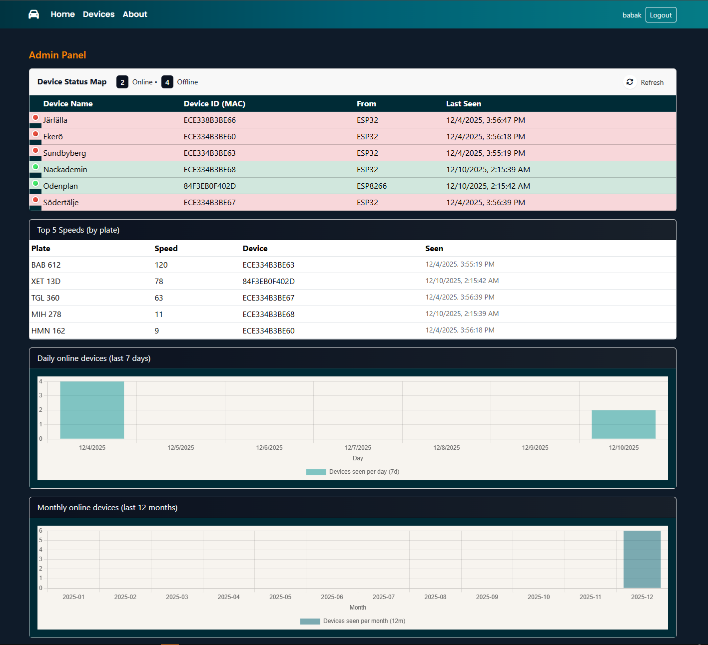
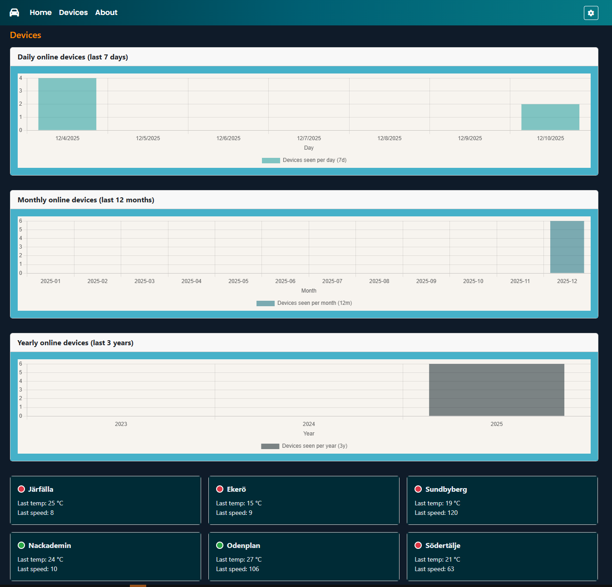
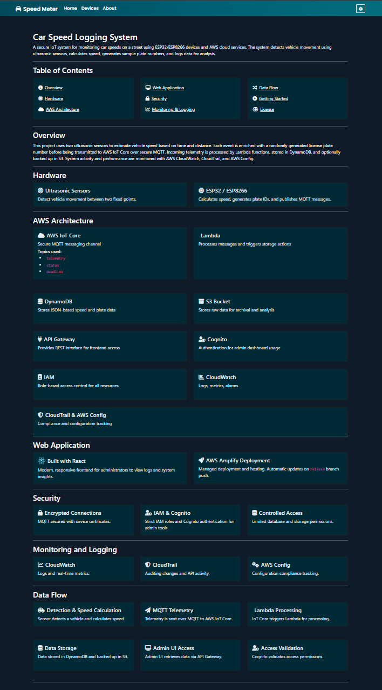

## Table of Contents

---

---

## 🔎 Overview

A secure IoT system for monitoring car speeds on a street using ESP32/ESP8266 devices and AWS cloud services. The system detects vehicle movement using ultrasonic sensors, calculates speed, generates sample plate numbers, and logs data for analysis.

---

## 🔧 Hardware

**Ultrasonic Sensors**
> Detect vehicle movement between two fixed points.

**ESP32 / ESP8266**
> Calculates speed, generates plate IDs, and publishes MQTT messages.

---

## ☁️ AWS Architecture

**AWS IoT Core**
> Secure MQTT messaging channel

**Topics used:**
`telemetry`, `status`, `deadlink`

**Lambda**
> Processes messages and triggers storage actions

**DynamoDB**
> Stores JSON-based speed and plate data

**S3 Bucket**
> Stores raw data for archival and analysis

**API Gateway**
> Provides REST interface for frontend access

**Cognito**
> Authentication for admin dashboard usage

**IAM**
> Role-based access control for all resources

**CloudWatch**
> Logs, metrics, alarms

**CloudTrail & AWS Config**
> Compliance and configuration tracking

---
### 🔊 MQTT Topics

The system uses three dedicated MQTT topics to separate message types clearly:

| Topic Name | Purpose | Publisher | Consumer |
|-----------|---------|-----------|----------|
| `telemetry` | Speed + simulated temperature, humidity, and plate data | ESP32 / ESP8266 | AWS IoT Core → Lambda → DynamoDB |
| `status` | Online/offline status, heartbeat checking | ESP32 / ESP8266 | AWS IoT Core → Device Shadow |
| `deadlink` | Reports lost connection to detect offline devices | ESP32 / ESP8266 | AWS IoT Core / Monitoring tools |

**Routing Rules**
- IoT Core Rule Engine forwards **telemetry** messages to Lambda for processing
- **status** messages update the Device Shadow state
- **deadlink** messages allow monitoring and alerting if connection drops

This structured approach makes the system easier to scale, debug and monitor.

---
## 💻 Web Application

	
	Built with React

Modern, responsive frontend for administrators to view logs and system insights.

**AWS Amplify Deployment**
> Managed deployment and hosting. Automatic updates on `release` branch push.

**IoT Core – Connected Device Status**

<figure style="text-align:center; margin: 0 0 1rem 0;">
	
	<figcaption style="color:#6c757d; margin-top:8px; font-size:0.95em;"><strong> Projects Homepage</strong></figcaption>
</figure>

<figure style="text-align:center; margin: 0 0 1rem 0;">
	
	<figcaption style="color:#6c757d; margin-top:8px; font-size:0.95em;"><strong>Admin Page (dashboard view)</strong></figcaption>
</figure>

<figure style="text-align:center; margin: 0 0 1rem 0;">
	
	<figcaption style="color:#6c757d; margin-top:8px; font-size:0.95em;"><strong> Devices list and cards</strong></figcaption>
</figure>

<figure style="text-align:center; margin: 0 0 1rem 0;">
	
	<figcaption style="color:#6c757d; margin-top:8px; font-size:0.95em;"><strong> About page / project info</strong></figcaption>
</figure>

---

## 🔒 Security

### Credential Protection

>To avoid exposing secrets inside firmware or code:

- MQTT certificates and private keys are stored in a separate `secrets.h` file
- Sensitive credentials are NOT hard-coded inside main program files
- Only compiled devices contain these credentials
- This prevents accidental leakage if the project source code is shared publicly (ex: GitHub)

This ensures secure handling of device identity materials.

### API Gateway Security

>Admin endpoints require Cognito authentication and enforce JWT validation  
 Public endpoints are **READ-ONLY** and provide **limited telemetry**  
 All API traffic is encrypted using HTTPS  

**Encrypted Connections**
> MQTT secured with device certificates.

**IAM & Cognito**
> Strict IAM roles and Cognito authentication for admin tools.

**Controlled Access**
> Limited database and storage permissions.

---

## 📈 Scalability

The solution is built using fully managed AWS services that automatically scale when more devices are connected.

- **AWS IoT Core**  
  - Handles secure MQTT messaging for a large number of devices
  - Scaling is fully automatic

- **AWS Lambda**  
  - Event-driven compute scales based on incoming IoT messages
  - No servers to manage

- **DynamoDB**  
  - Automatically adjusts throughput capacity
  - Stores increasing telemetry data without performance loss

- **S3 Storage**  
  - Designed for virtually unlimited storage
  - Ideal for long-term history and datasets

- **AWS Amplify (Web Hosting + CI/CD)**  
  - Automatic deployment pipeline for fast updates
  - Scales frontend delivery to many users

> This architecture allows the project to move from a small simulation to a large production deployment without redesigning the system.

---
## 🧪 Data & Simulation Notes

- **Speed (Real Measurement)**
  - Speed is calculated from the time difference between Ultrasonic Sensor A and Ultrasonic Sensor B
  - The distance between the sensors is a fixed known value
  - Formula used:
  
    **Speed = Distance / Time**

- **Temperature**
  - Randomly generated simulation value

- **Humidity**
  - Randomly generated simulation value

- **License Plate**
  - Random generated and does not verify if the detected object is a real car

This version demonstrates a real physical speed calculation while simulating additional telemetry values for a complete IoT data pipeline.

---

## 📊 Monitoring and Logging

**CloudWatch**
> Logs and real-time metrics.

**CloudTrail**
> Auditing changes and API activity.

**AWS Config**
> Configuration compliance tracking.

---
## 🔀 Data Flow

### 1️⃣ Detection & Speed Calculation
- Ultrasonic Sensor A detects object first
- Ultrasonic Sensor B detects object second
- Time difference is measured
- Speed is calculated using:

  **Speed = Distance / Time**

- Temperature, humidity, and license plate values are generated randomly

---

### 2️⃣ MQTT Telemetry
- Device publishes data to AWS IoT Core over MQTT
- Topics used:
  - `telemetry`
  - `status`
  - `deadlink`

---

### 3️⃣ lambda Processing
- IoT Core routing rules trigger Lambda
- Lambda processes telemetry payload
- Data is stored in **DynamoDB**
- Raw data is also archived in **S3 Bucket**

---

### 4️⃣ Web Access via API Gateway
- API Gateway provides REST APIs for the UI

API Types:
- **Public API** → Public page can fetch limited telemetry (no Cognito required)
- **Admin API** → Secure routes protected with Cognito JWT authentication

---

### 5️⃣ Authentication Validation
- Cognito validates admin access permissions
- All API traffic uses secure HTTPS

---

## 🚀 Getting Started

1. Clone the repository
2. Create AWS IoT Core resources and download certificates
3. Set up DynamoDB, Lambda, S3, API Gateway, Cognito, and CloudWatch
4. Flash firmware code to ESP32/ESP8266 boards
5. Configure WiFi and MQTT certificates on the devices
6. Deploy the web interface with Amplify and connect to GitHub

---

## ⚖️ License
MIT License. See [License](./LICENSE) file for details.
